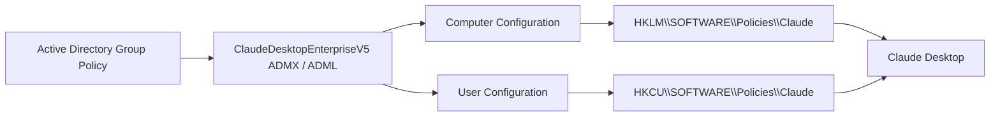
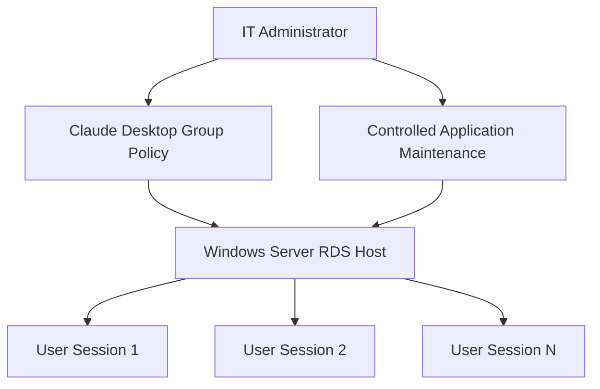

<div align="center">

# Claude Desktop Enterprise Group Policy Templates

### ADMX / ADML templates for centralized Claude Desktop configuration on Windows

**Template:** `ClaudeDesktopEnterpriseV5`  
**Platforms:** Windows 11 · Windows Server 2019 · Windows Server 2022 · Windows Server 2025

</div>

---

## Overview

`ClaudeDesktopEnterpriseV5` provides custom Windows Administrative Templates for managing Claude Desktop enterprise settings through Active Directory Group Policy.

The package consists of:

| File | Purpose |
|---|---|
| `ClaudeDesktopEnterpriseV5.admx` | Language-neutral Group Policy definitions and registry mappings |
| `en-US/ClaudeDesktopEnterpriseV5.adml` | English policy names, descriptions, help text, and presentation resources |

The templates translate Claude Desktop's enterprise registry settings into standard **Computer Configuration** and **User Configuration** policies. This removes the need to configure supported Claude settings manually with Registry Editor and makes configuration consistent across domain-managed Windows systems.

> **Note:** These templates configure Claude Desktop policy values only. They do not install, update, or remove the Claude Desktop application.

---

## Supported Windows Platforms

| Operating system | Usage |
|---|---|
| **Windows 11** | Domain-managed workstations |
| **Windows Server 2019** | Servers and Remote Desktop Session Hosts |
| **Windows Server 2022** | Servers and Remote Desktop Session Hosts |
| **Windows Server 2025** | Servers and Remote Desktop Session Hosts |

---

## How It Works



Claude Desktop enterprise policies are written to:

```text
Computer policies:
HKEY_LOCAL_MACHINE\SOFTWARE\Policies\Claude

User policies:
HKEY_CURRENT_USER\SOFTWARE\Policies\Claude
```

Machine policies are useful for enforcing a consistent configuration across the entire computer or shared RDS host. User policies provide per-user configuration where that scope is appropriate.

---

## Available Policy Categories

The template organizes Claude Desktop management into the following categories:

- **Authentication**
- **Automatic Updates**
- **Claude Code**
- **Cowork**
- **Features**

### Included Settings

| Group Policy setting | Registry value | Type | Scope |
|---|---|---|---|
| Disable Automatic Updates | `disableAutoUpdates` | `REG_DWORD` | Computer / User |
| Automatic Update Enforcement Hours | `autoUpdaterEnforcementHours` | `REG_DWORD` | Computer / User |
| Force Login Organization UUID | `forceLoginOrgUUID` | `REG_SZ` | Computer / User |
| Enable Desktop Extensions | `isDesktopExtensionEnabled` | `REG_DWORD` | Computer / User |
| Enable Desktop Extension Directory | `isDesktopExtensionDirectoryEnabled` | `REG_DWORD` | Computer / User |
| Enable Local Development MCP Servers | `isLocalDevMcpEnabled` | `REG_DWORD` | Computer / User |
| Enable Claude Code for Desktop | `isClaudeCodeForDesktopEnabled` | `REG_DWORD` | Computer / User |
| Default Claude Code Effort Level | `effortLevel` | `REG_SZ` | Computer / User |
| Enable Secure VM and Cowork Features | `secureVmFeaturesEnabled` | `REG_DWORD` | Computer / User |
| Allowed Workspace Folders | `allowedWorkspaceFolders` | `REG_SZ` | Computer / User |
| Cowork EDR Sensor Package Path | `coworkEDRIntegration` | `REG_SZ` | Computer |
| Cowork EDR Integration Vendor | `coworkEDRIntegrationVendor` | `REG_SZ` | Computer |

Where Claude requires structured multiple values, the value is stored using the format documented by Claude, including JSON-formatted text where applicable.

---

## Installation

Copy the template files to the Active Directory Group Policy Central Store:

```text
\\<domain>\SYSVOL\<domain>\Policies\PolicyDefinitions\
│
├── ClaudeDesktopEnterpriseV5.admx
└── en-US\
    └── ClaudeDesktopEnterpriseV5.adml
```

After copying the files, close and reopen **Group Policy Management Console** / **Group Policy Management Editor**.

You should then see:

```text
Computer Configuration
└── Policies
    └── Administrative Templates
        └── Claude Desktop

User Configuration
└── Policies
    └── Administrative Templates
        └── Claude Desktop
```

Only one ADMX template using the same Claude Desktop target namespace should exist in the Central Store.

---

## Example: Disable Claude Desktop Automatic Updates

For centrally managed systems, the template allows automatic updates to be controlled through Group Policy.

Configure:

```text
Computer Configuration
└── Policies
    └── Administrative Templates
        └── Claude Desktop
            └── Automatic Updates
                └── Disable Automatic Updates
```

Set the policy to:

```text
Enabled
```

The resulting machine policy is:

```text
HKEY_LOCAL_MACHINE\SOFTWARE\Policies\Claude

Value: disableAutoUpdates
Type:  REG_DWORD
Data:  1
```

This is particularly useful on multi-user Remote Desktop Session Hosts where application servicing should be controlled centrally rather than independently by each user session.

---

## RDS Deployment Model



For an RDS environment, machine-level policies provide a common Claude Desktop configuration for every session on the host.

A centrally managed servicing model can therefore separate:

- **Application configuration** through Group Policy
- **Application installation and updates** through the organization's software deployment process
- **Maintenance** through controlled RDS servicing windows

---

## Verify Applied Policies

Refresh Group Policy:

```cmd
gpupdate /force
```

Verify the automatic-update policy:

```cmd
reg query "HKLM\SOFTWARE\Policies\Claude" /v disableAutoUpdates
```

Expected result when the policy is enabled:

```text
disableAutoUpdates    REG_DWORD    0x1
```

Check applied computer GPOs:

```cmd
gpresult /r /scope computer
```

Generate a detailed Group Policy report:

```cmd
gpresult /h C:\Temp\Claude-GPO-Result.html /f
```

For user-level Claude policies:

```cmd
reg query "HKCU\SOFTWARE\Policies\Claude"
```

---

## Important Deployment Notes

- Keep the ADMX and ADML base filenames identical: `ClaudeDesktopEnterpriseV5`.
- Place the ADML file in the appropriate language resource directory, such as `en-US`.
- Do not keep duplicate Claude ADMX files that define the same target namespace in the Central Store.
- Use **Computer Configuration** for settings that need to apply consistently to every user of a shared server or RDS host.
- Validate policy behavior before deploying a new configuration broadly through Active Directory.
- Review the current Claude enterprise documentation before extending the template with new registry settings.

---

## Official Documentation

The registry settings represented by these templates are based on Claude's official enterprise configuration documentation:

**[Enterprise configuration for Claude Desktop](https://support.claude.com/en/articles/12622667-enterprise-configuration-for-claude-desktop)**

The official documentation should remain the authoritative reference for supported Claude Desktop enterprise settings, registry value formats, and future configuration changes.

---

## About the System Administrator

For more technical content like this, as well as professional **technical support and consulting** related to **Active Directory, Group Policy, Windows Server, Remote Desktop Services, infrastructure operations, and systems administration**, you can connect with the system administrator through Medium.

**Technical articles & contact:** [ahmetdoruk.medium.com](https://ahmetdoruk.medium.com)

The Medium page focuses on practical enterprise IT implementations, troubleshooting, infrastructure administration, and real-world system management topics.

---

<div align="center">

**ClaudeDesktopEnterpriseV5**  
`ADMX` · `ADML` · `Active Directory` · `Group Policy` · `Windows` · `Windows Server` · `RDS`

</div>
