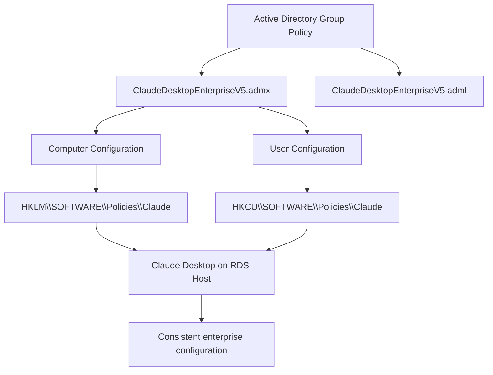
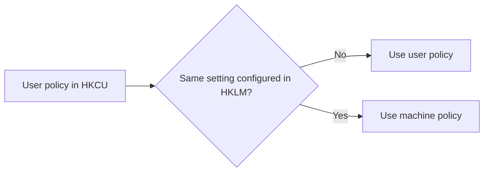
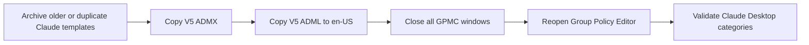
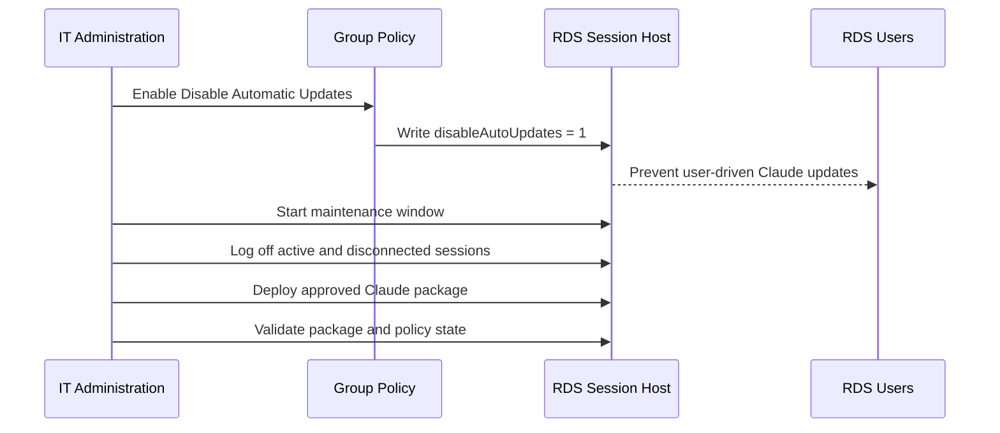

<div align="center">

# Claude Desktop Enterprise Group Policy Templates

### Centralized Claude Desktop policy management for Windows domains and RDS

<p>
  
  
  
  
</p>

<p>
  Custom Administrative Templates for managing Claude Desktop enterprise registry settings through Active Directory Group Policy.
</p>

</div>

---

## Overview

This package provides the final custom Administrative Template files used to manage Claude Desktop in a Windows domain:

| File | Purpose |
|---|---|
| `ClaudeDesktopEnterpriseV5.admx` | Language-neutral policy definitions and registry mappings |
| `en-US/ClaudeDesktopEnterpriseV5.adml` | English names, descriptions, help text, and policy interface resources |

> [!IMPORTANT]
> These templates configure Claude Desktop policy registry values. Backup registry for any problem.

---

## Supported Windows Platforms

| Operating system | Intended use |
|---|---|
| **Windows 11** | Domain-joined workstation policy management |
| **Windows Server 2019** | Server and Remote Desktop Session Host policy management |
| **Windows Server 2022** | Server and Remote Desktop Session Host policy management |
| **Windows Server 2025** | Server and Remote Desktop Session Host policy management |

The templates use standard ADMX/ADML Group Policy definitions and registry-backed policy values under `SOFTWARE\Policies\Claude`.

---

## Why This Was Created

Claude Desktop enterprise settings are configured through these registry locations:

```text
HKEY_LOCAL_MACHINE\SOFTWARE\Policies\Claude
HKEY_CURRENT_USER\SOFTWARE\Policies\Claude
```

Editing these values manually is acceptable for testing, but it does not provide consistent control across domain-joined computers, shared Remote Desktop Session Hosts, or multiple user profiles.

The templates convert the documented registry settings into standard Group Policy controls so administrators can:

<table>
<tr>
<td width="50%">

### Centralize configuration

- Manage Claude Desktop through GPMC
- Apply machine-wide RDS policies
- Apply user-specific settings when required
- Maintain consistent settings across servers

</td>
<td width="50%">

### Improve operations

- Verify settings with `gpresult`
- Audit values in the registry
- Prevent user-managed update behavior
- Separate application deployment from policy management

</td>
</tr>
</table>

The original operational requirement was a Windows Server Remote Desktop Services environment. The template is intended for Windows 11 and Windows Server 2019, 2022, and 2025; the RDS implementation that initiated this work used Windows Server 2022 where Claude Desktop per-user updates could conflict with active or disconnected user sessions. Central policy control allows automatic updates to be disabled and application servicing to be performed during a controlled maintenance window.

---

## Architecture



### Policy precedence



The templates support both scopes:

```text
Computer Configuration -> HKEY_LOCAL_MACHINE\SOFTWARE\Policies\Claude
User Configuration     -> HKEY_CURRENT_USER\SOFTWARE\Policies\Claude
```

For shared RDS servers, update, security, and feature-control settings should normally be configured under **Computer Configuration**.

---

## Included Policy Areas

<div align="center">

| Policy area | Purpose |
|---|---|
| 🔄 **Automatic Updates** | Disable user-driven updates and define update enforcement behavior |
| 🔐 **Authentication** | Restrict sign-in to approved organization UUIDs |
| 🧩 **Features** | Control extensions, extension directory access, and local MCP servers |
| 💻 **Claude Code** | Control Claude Code availability and default effort level |
| 🗂️ **Cowork** | Control Secure VM, workspace folders, and EDR integration |

</div>

### Registry mappings

| Group Policy setting | Registry value | Registry type | Scope |
|---|---|---:|---|
| Disable Automatic Updates | `disableAutoUpdates` | `REG_DWORD` | Computer and User |
| Automatic Update Enforcement Hours | `autoUpdaterEnforcementHours` | `REG_DWORD` | Computer and User |
| Force Login Organization UUID | `forceLoginOrgUUID` | `REG_SZ` | Computer and User |
| Enable Desktop Extensions | `isDesktopExtensionEnabled` | `REG_DWORD` | Computer and User |
| Enable Desktop Extension Directory | `isDesktopExtensionDirectoryEnabled` | `REG_DWORD` | Computer and User |
| Enable Local Development MCP Servers | `isLocalDevMcpEnabled` | `REG_DWORD` | Computer and User |
| Enable Claude Code for Desktop | `isClaudeCodeForDesktopEnabled` | `REG_DWORD` | Computer and User |
| Default Claude Code Effort Level | `effortLevel` | `REG_SZ` | Computer and User |
| Enable Secure VM and Cowork Features | `secureVmFeaturesEnabled` | `REG_DWORD` | Computer and User |
| Allowed Workspace Folders | `allowedWorkspaceFolders` | `REG_SZ` | Computer and User |
| Cowork EDR Sensor Package Path | `coworkEDRIntegration` | `REG_SZ` | Computer only |
| Cowork EDR Integration Vendor | `coworkEDRIntegrationVendor` | `REG_SZ` | Computer only |

> [!NOTE]
> Settings that accept multiple entries, such as organization UUIDs or allowed workspace folders, are stored as JSON text in a `REG_SZ` value, not as `REG_MULTI_SZ`.

---

## Final V5 Corrections

The final templates include the following corrections made during validation:

<table>
<tr>
<th>Issue</th>
<th>Final correction</th>
</tr>
<tr>
<td>Policies with input elements failed to load</td>
<td>Added a matching ADML presentation reference for every ADMX <code>&lt;elements&gt;</code> policy.</td>
</tr>
<tr>
<td>Duplicate namespace error</td>
<td>Only one ADMX file may use <code>Anthropic.Policies.ClaudeDesktop</code> in the Central Store.</td>
</tr>
<tr>
<td>Category and policy names appeared indented</td>
<td>All visible ADML strings are written inline without leading line breaks, tabs, or indentation.</td>
</tr>
<tr>
<td>Presentation controls did not match policy elements</td>
<td>Presentation IDs and element <code>refId</code> values now match exactly.</td>
</tr>
<tr>
<td>EDR settings appeared in the wrong scope</td>
<td>EDR integration policies are exposed only under Computer Configuration.</td>
</tr>
</table>

### Whitespace correction

The final ADML intentionally uses inline display strings:

```xml
<string id="CAT_Authentication">Authentication</string>
```

This multi-line form is avoided for titles and category names:

```xml
<string id="CAT_Authentication">
    Authentication
</string>
```

Some Group Policy Editor views may preserve the leading newline and indentation from a multi-line XML text node. The inline format prevents visible spaces before category and policy names.

---

## Central Store Installation

### Required structure

```text
\\<domain>\SYSVOL\<domain>\Policies\PolicyDefinitions\
│
├── ClaudeDesktopEnterpriseV5.admx
└── en-US\
    └── ClaudeDesktopEnterpriseV5.adml
```

### Installation flow



1. Archive or remove duplicate or obsolete Claude ADMX and ADML files that use the same target namespace.
2. Copy `ClaudeDesktopEnterpriseV5.admx` to `PolicyDefinitions`.
3. Copy `ClaudeDesktopEnterpriseV5.adml` to `PolicyDefinitions\en-US`.
4. Close every open Group Policy Management Console and Group Policy Management Editor window.
5. Reopen GPMC and confirm the **Claude Desktop** category loads without errors.

> [!WARNING]
> Do not keep another Claude ADMX in the Central Store if it defines the same target namespace `Anthropic.Policies.ClaudeDesktop`.

---

## Recommended Windows RDS Configuration

For Windows Server 2019, 2022, or 2025 used as an RDS Session Host, configure the automatic-update policy at machine scope:

```text
Computer Configuration
└── Policies
    └── Administrative Templates
        └── Claude Desktop
            └── Automatic Updates
                └── Disable Automatic Updates = Enabled
```

Expected registry result:

```text
Key:   HKEY_LOCAL_MACHINE\SOFTWARE\Policies\Claude
Name:  disableAutoUpdates
Type:  REG_DWORD
Data:  1
```

### Managed update model



This model prevents Claude Desktop from attempting independent per-user updates during shared RDS sessions. Application updates can be performed centrally after active and disconnected sessions have been logged off.

---

## Verification

### Refresh Group Policy

```cmd
gpupdate /force
```

### Verify the machine-level update policy

```cmd
reg query "HKLM\SOFTWARE\Policies\Claude" /v disableAutoUpdates
```

Expected result:

```text
disableAutoUpdates    REG_DWORD    0x1
```

### Verify applied computer policies

```cmd
gpresult /r /scope computer
```

### Generate a detailed HTML report

```cmd
gpresult /h C:\Temp\Claude-GPO-Result.html /f
```

### Verify user-scoped Claude policies

```cmd
reg query "HKCU\SOFTWARE\Policies\Claude"
```

### Quick health checklist

- [ ] Claude Desktop V5 appears in Administrative Templates.
- [ ] No namespace or presentation errors are displayed.
- [ ] Category and policy names contain no leading spaces.
- [ ] The intended GPO appears in `gpresult`.
- [ ] `disableAutoUpdates` exists as `REG_DWORD` with value `1`.
- [ ] Old Claude ADMX versions have been removed from the Central Store.
- [ ] Application updates are handled through a controlled maintenance process.

---

## Troubleshooting

<details>
<summary><strong>Namespace is already defined</strong></summary>

Another ADMX file in the Central Store uses the same target namespace. Search for:

```text
Anthropic.Policies.ClaudeDesktop
```

Keep only the final V5 ADMX file and archive older versions.

</details>

<details>
<summary><strong>An appropriate resource file could not be found</strong></summary>

Confirm that the ADML filename matches the ADMX base filename and that the ADML exists in the correct language folder:

```text
PolicyDefinitions\ClaudeDesktopEnterpriseV5.admx
PolicyDefinitions\en-US\ClaudeDesktopEnterpriseV5.adml
```

</details>

<details>
<summary><strong>Policy contains elements but has no presentation reference</strong></summary>

The ADMX policy must include a presentation reference, and the ADML presentation must use matching `refId` values for the ADMX elements.

</details>

<details>
<summary><strong>Category or policy names contain leading spaces</strong></summary>

Define visible ADML strings on a single line. Avoid line breaks and indentation inside display-name `<string>` elements.

</details>

---

## Operational Notes

- Use **Computer Configuration** for shared RDS hosts so every session receives the same machine policy.
- Keep ADMX and ADML base filenames identical.
- Retain `en-US` as the English resource folder.
- Test future revisions in a non-production Group Policy environment.
- Use a maintenance window for Claude Desktop package updates on RDS.
- Confirm that both active and disconnected user sessions are logged off before servicing application packages.
- Review the official Claude documentation before adding new policies or changing value formats.

---

## Source

The policy names, registry paths, supported values, and enterprise configuration behavior are based on the official Claude documentation:

- [Enterprise configuration for Claude Desktop](https://support.claude.com/en/articles/12622667-enterprise-configuration-for-claude-desktop)

---

<div align="center">

### Final result

**Claude Desktop policies can now be administered through standard Active Directory Group Policy instead of manual registry changes.**

`ADMX` · `ADML` · `Windows Server 2022` · `RDS` · `Group Policy`

</div>

---

## About the System Administrator

For more technical content like this, as well as professional information, support, and consulting on **Active Directory, Group Policy, Windows Server, Remote Desktop Services, infrastructure operations, and systems administration**, you can connect with the system administrator through Medium.

**Contact & technical articles:** [ahmetdoruk.medium.com](https://ahmetdoruk.medium.com)

Follow the Medium page for practical enterprise IT guides, troubleshooting notes, implementation examples, and real-world system administration content.
